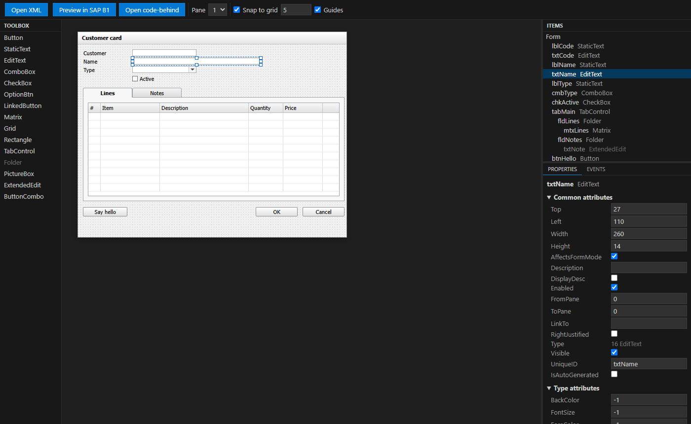
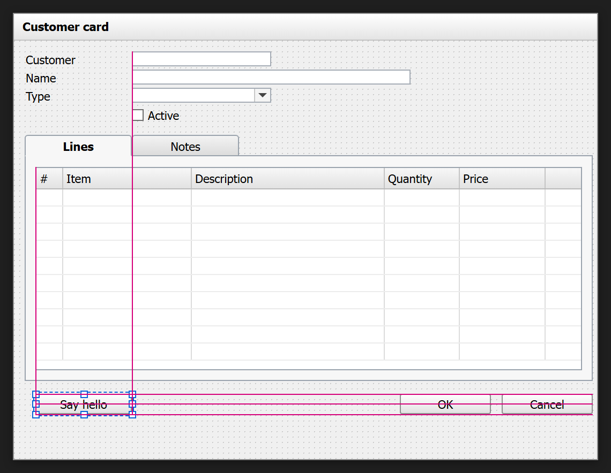
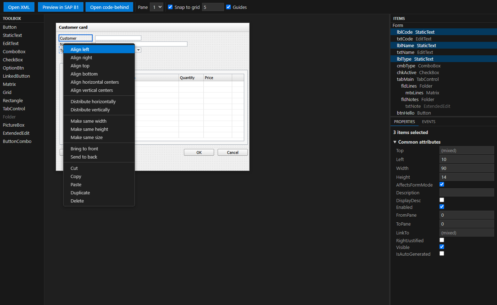
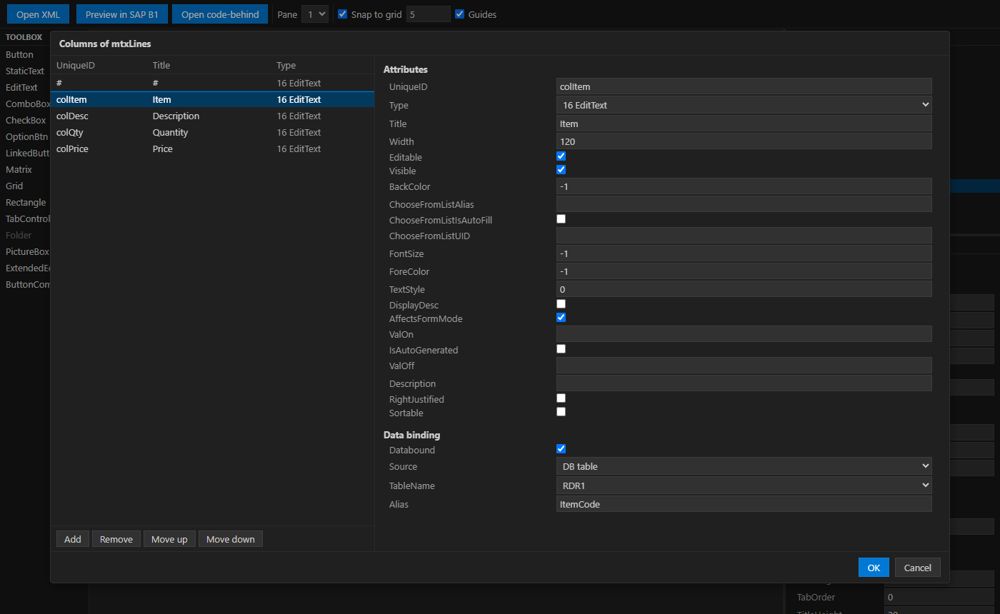
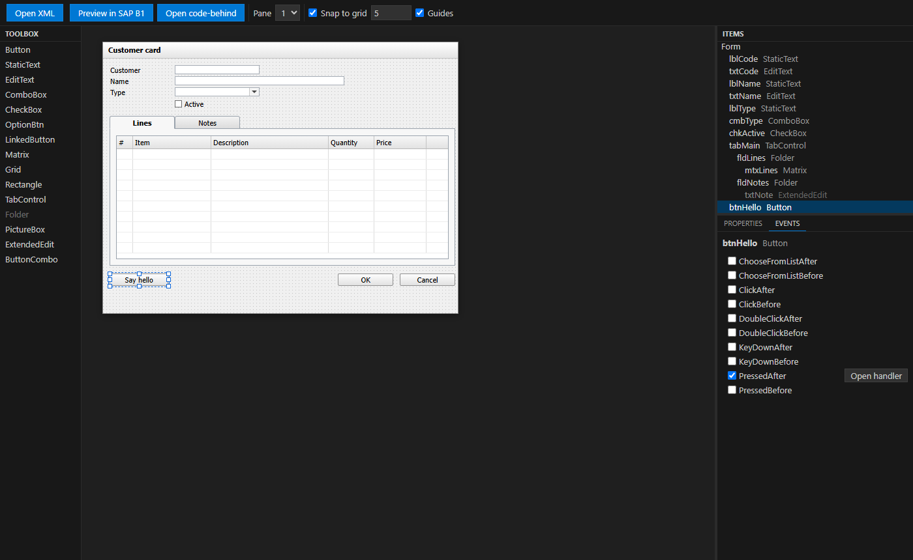

# B1 DevKit for SAP Business One

Build, run and debug SAP Business One add-ons (C# and VB.NET, .NET Framework) from VS Code, with the F5 workflow you know from other IDEs.

> **Preview.** B1 DevKit is in preview: please report problems and ideas in the Q & A tab of the Marketplace page.

> SAP and SAP Business One are trademarks of SAP SE. This extension is an independent project and is not affiliated with, endorsed by or sponsored by SAP.



## Features

- **Add-on detection.** Projects (`.csproj`, `.vbproj`, old-style or SDK-style) that reference the SAP Business One SDK/UI API and produce an executable are recognised as add-ons. With several add-ons in the workspace, pick the active one from the status bar.
- **Build and rebuild** through MSBuild, solution-aware, with errors reported in the Problems panel. Available as commands and as `sapb1` tasks usable from `tasks.json` (see below).
- **Debug (F5)** and **Run without debugging (Ctrl+F5)**: checks the SAP Business One client, offers to terminate a copy of the add-on that is still running (its executable is locked, so it could not be rebuilt), builds the add-on, then starts it with the SAP development connection string under the .NET Framework debugger.
- **Attach** to an add-on that is already running.
- **Client helper.** Detects whether the SAP Business One client is installed, 64-bit and running, and can start it for you.
- **New add-on project** command that scaffolds an SDK-style project, a menu example and a `launch.json`.
- **Forms.** Edit SAP Business One form files (`.b1f`, `.srf`) with a visual designer, a forms tree, a live preview in the SAP client and `.b1s` generation (see [Forms](#forms)).
- **Add-on package.** **SAP B1: Package add-on** builds the add-on and writes the zip that the Extension Manager imports, without the SAP SDK tools (see [Add-on package](#add-on-package)).
- Italian and English user interface.

## Requirements

- Windows x64: the extension is published for Windows x64 only. A Windows workspace (local, or VS Code connected to a Windows machine). In other workspaces the commands are hidden and, if run anyway, explain that Windows is required.
- MSBuild 17.8 or later, from Visual Studio 2022 17.8+ or the Visual Studio Build Tools (or set `sapb1.msbuildPath`). If neither is found, `dotnet msbuild` is used with a warning: it cannot build projects with `COMReference` and some Visual Studio targets.
- The C# extension (`ms-dotnettools.csharp`), installed automatically as a dependency. It provides the .NET Framework debugger.
- The **64-bit** SAP Business One client.
- Add-ons must be **64-bit** (`PlatformTarget` x64, or AnyCPU without `Prefer32Bit`) to be debugged.

## Getting started

1. Open the folder that contains your add-on (or its solution) in VS Code.
2. Log in to a company in the SAP Business One client, or let the extension start it for you.
3. Press **F5**. The extension builds the add-on and starts it under the debugger. Without a `launch.json`, a default configuration for the active add-on is used.

To start from scratch, run **SAP B1: New add-on project** from the Command Palette: the commands are available in any Windows workspace, even an empty folder. The project gets a `launch.json` entry named `Debug SAP B1 add-on (<name>)`. To create the debug configurations in an existing workspace, run **SAP B1: Create launch.json**.

Form commands are described in [Forms](#forms). Other commands (Command Palette, category "SAP B1"): Select active add-on, Build add-on, Rebuild add-on, Start debugging, Run without debugging, Attach to running add-on, Start SAP Business One client, Show log.

## Guide: your first add-on with a form

This walkthrough goes from an empty folder to a running add-on with its own form. It takes about ten minutes.

### 1. Create the add-on

1. Open an empty folder in VS Code.
2. Run **SAP B1: New add-on project** from the Command Palette (`Ctrl+Shift+P`) and enter a name, for example `MyAddon`. You get an SDK-style C# project with a `Program.cs`, a `Menu.cs` that adds a menu under *Modules* and a `launch.json`.
3. Log in to a company in the SAP Business One client and press **F5**. The add-on is built and started under the debugger: its menu appears under *Modules → MyAddon*, and breakpoints in `Menu.cs` are hit.

### 2. Create a form

1. Run **SAP B1: New form** (also in the title bar of the **SAP B1 Forms** view in the Explorer), choose **UserForm** and enter a name, for example `CustomerCard`.
2. You get `CustomerCard.b1f`, its code-behind `CustomerCard.b1f.cs` (nested under the form in the Explorer) and the two entries in the `.csproj`. The form opens in the designer.

### 3. Design the form

- Drag items from the **toolbox** onto the form, or double-click them. Select them with a click, Ctrl+click or a rubber band, move them with the mouse or the arrow keys and resize them with the handles.
- Set the attributes in the **Properties** panel: position and size, caption, data binding (DB table, user data source or DataTable column), the values of a combo box. With several items selected, a change applies to all of them.
- While you drag, **alignment guides** snap the item to the edges and centers of the other items; hold **Alt** to place it freely.



- Right-click a selection to align the items, make them the same size, or **distribute** three or more items at equal distances.



- For a matrix or a grid, **Edit columns…** opens the columns dialog: the column list on the left, the attributes and the data binding of the selected column on the right. **OK** applies everything as one undo step.



### 4. Handle the events in C#

Select an item and open the **Events** tab: tick an event to create its handler in the code-behind, **Open handler** jumps to the method. Double-clicking an item on the form creates the handler of its default event (for a button, the click). Write your code in the handler, for example:

```csharp
private void Button0_PressedAfter(object sboObject, SAPbouiCOM.SBOItemEventArg pVal)
{
    Application.SBO_Application.MessageBox("Hello " + this.EditText1.Value);
}
```



### 5. See it in SAP Business One

- **Preview in SAP B1** (designer toolbar) loads the form in the running client with the real controls, and reloads it after each change. You can check the result without starting the add-on.
- To open the form from the add-on, call `new CustomerCard().Show();`, for example in the handler of a menu in `Menu.cs`. Press **F5**: the add-on is built, the `.b1s` with the form is generated next to the executable, and the menu opens your form.

The rest of the features (system forms and UDO forms, capture from the client, legacy `.srf` files, `.b1s` generation) are described below.

## Forms

B1 DevKit edits the form files of a SAP Business One add-on and keeps them in step with the C# code.

### Form files and the XML editor

- `.b1f` (the form files of B1 Studio: UserForm, SystemForm and UDOForm) and `.srf` (the XML format of the SAP client) are recognised, with syntax highlighting, an outline (form, data sources, items, columns), hover on the item type, completion of types, booleans and item uids, and validation in the Problems panel. **Open form XML** opens the file as text.
- A `.b1f` is written in the format of B1 Studio (UTF-16 LE with BOM, CRLF, two-space indent), so that a file saved by B1 DevKit opens in B1 Studio and the other way round. A `.b1f` that you open and save without changes is byte-identical.
- In the C# files of an add-on, item uids are completed and checked inside `GetItem("…")` and `GetSpecificItem("…")`, **Go to definition** jumps to the item in the `.b1f`, and a `[Form(…)]` resource that does not match the path of the `.b1f` is reported with a quick fix (**Fix form resources** does the whole add-on).
- **Convert to .b1f** turns a legacy `.srf` into a `.b1f` with code-behind. The `.srf` and the code that loads it are not touched.

### Forms tree

The **SAP B1 Forms** view (Explorer) lists the add-ons and their forms, with an icon per category. From it: open the XML, the designer or the code-behind, preview, reveal in Explorer, convert a `.srf`, capture the original of a SystemForm, save a UDOForm to the database. The view title has **New form** and **Capture form from SAP Business One client**.

In the Explorer, the code-behind (`<name>.b1f.cs`) and the original of a SystemForm (`<name>.b1f__orig_srf`) are nested under their `.b1f`, as in Visual Studio. The extension turns on `explorer.fileNesting.enabled` by default for this; set it to `false` to turn nesting off.

### Designer

A `.b1f` opens in the designer by default; **Open XML** (or **Reopen Editor With… → Text Editor**) shows its XML. A legacy `.srf` opens as XML; **Open form in designer** opens it in the designer. The form is drawn in the style of SAP Business One:

- a **toolbox** with the item types (button, static text, edit text, combo box, check box, option button, linked button, matrix, grid, rectangle, folder/tab control, picture box, extended edit, button combo). Drag an item onto the form or double-click it in the toolbox; it gets the first free uid `Item_<n>`;
- a **properties** panel for the form (attributes, user data sources and DataTables) and for the selected item (common and type-specific attributes, data binding to a DB table, a user data source or a DataTable column, ValidValues, and the columns of matrices and grids);
- an **events** panel with the UI API events of the form and of the selected item; double-clicking an item creates the handler of its default event;
- selection with click, Ctrl+click or rubber band; move with the mouse or the arrow keys (1 px, 10 px with Shift); resize with 8 handles; alignment, equal size, z-order, cut, copy, paste, duplicate and delete; undo and redo of VS Code. The grid is set by `sapb1.forms.designer.snap` (also in the designer toolbar);
- a pane selector, to see the items of each pane of a form with folders.

**Alignment guides and distribution.** While you drag or resize an item with the mouse, its edges and centers snap to those of the other items of the pane and to the edges of the form when they are within 4 px, as the snaplines of the Visual Studio designer: left with left, right with right, center with center, and an edge against the opposite one to put two fields side by side. Pink guide lines show the alignment while you drag. Where no guide is near, the grid applies as before. Hold **Alt** to place the item freely, without guides or grid; the arrow keys always move by 1 px (10 px with Shift). The guides are set by `sapb1.forms.designer.guides` (also the **Guides** check box in the designer toolbar). With three or more items selected, **Distribute horizontally** and **Distribute vertically** in the context menu make the spaces between them equal: the first and the last item stay where they are, and a tab control carries the items of its panes.

**Columns of matrices and grids.** **Edit columns…** in the properties panel opens a dialog with the columns on the left and the selected column on the right: its attributes, its data binding (matrix columns: DB table, user data source or DataTable column) and, for combo-box columns, its ValidValues. **OK** applies all the changes as one undo step; **Cancel** or Esc discards them.

**Code-behind sync.** When the `.b1f` has a code-behind class (`<name>.b1f.cs`), the changes made in the designer update the C# in the same edit, so one undo reverts both: adding an item adds the `SAPbouiCOM` field and its `GetItem` assignment in `OnInitializeComponent`, changing a uid rewrites the `GetItem` calls, removing an item removes the field, the assignment and the event hooks. Choosing an event adds the hook and a private handler with the right signature; removing the event from the panel removes the hook but keeps the method. Only the recognised areas are modified: if the class does not have the expected shape, the sync stops with a warning and writes nothing. Saving the form also saves the code-behind changes made by the designer; if the form is closed or reverted without saving, the code-behind is opened with a warning, and left for you to save or revert.

A `.b1f` that is not UTF-16 (the B1 Studio wizards write UTF-8) gives a warning when it is opened in the designer, with **Convert to UTF-16**.

The designer and the XML editor work on the same document: a change in one is shown in the other.

### Live preview

**Preview form in SAP Business One** loads the form in the running client, so you see it with the real controls:

- UserForms and `.srf` files open as a temporary form with uid and `FormType` `B1DK_P<n>`, replacing the previous preview;
- a SystemForm applies its changes to an open instance of the form (you are asked to open it if there is none);
- a UDOForm is previewed as a UserForm, without its business object: Add in the preview writes no record.

Errors reported by the client are shown as diagnostics on the file. With `sapb1.forms.previewOnSave` (default `true`) the preview is reloaded when the file is saved and 500 ms after each change made in the designer.

### Capture and wizards

- **Capture form from SAP Business One client** reads a form that is open in the client and saves it as a new UserForm (`.b1f`), as a `.srf`, or as a new SystemForm. A new UserForm does not keep the uid of the captured window, its business object (`ObjectType`), data browser and mode: the final message lists what was reset.
- **New form** creates the `.b1f`, the code-behind class and the `.csproj` entries (old-style and SDK-style projects, with targeted edits that keep encoding and formatting) for a **UserForm**, a **SystemForm** or a **UDOForm**. The SystemForm wizard starts from a form open in the client (or opens a system form from a menu you choose) and keeps its complete XML as `<Name>.b1f__orig_srf`. The UDO wizard lists the UDOs of the company and starts from the default form of the one you choose.
- **Capture original** (SystemForm) replaces the `__orig_srf` of an existing SystemForm with the current form of the client. The `.b1s` carries the difference between the `.b1f` and this original.
- **Save UDO form to DB** writes the form of a UDOForm in the `FormSRF` field of its UDO. This and the Service Layer variant (see [UDO forms from a company](#udo-forms-from-a-company)) are the only writes to the database that the extension makes. Before writing, a confirmation names the company and the database the client is connected to and the UDO that will be changed; nothing is written if you cancel.

### UDO forms from a company

You can bring the form of a UDO into a workspace folder, edit it in the designer and save it back, with the SAP Business One client or, without it, through the Service Layer.

- **Connections.** *SAP B1: Add Service Layer connection* asks for the URL (`https://server:50000/b1s/v1`, or just `server:50000`), the company database, the user and the password; *Remove Service Layer connection* deletes a connection. Connections are listed in the `sapb1.serviceLayer.connections` setting (user scope); the password is never written there, it is kept in VS Code's secret storage. If the server certificate is not trusted by the system, the extension shows it with its SHA-256 fingerprint and trusts it only after you accept. A certificate you trust is pinned: B1 DevKit connects to that server only while it presents exactly that certificate. If the server presents another one later, nothing is sent and an error offers **Trust the new certificate**, which shows the new certificate and pins it for the next connection if you trust it.
- **Import UDO forms…** lists the UDOs of the company (from a connection or from the company open in the client) and creates a `.b1f` for each one you choose, in any folder of the workspace or in an add-on. The form is the one stored in the UDO; if the UDO has none, it is the default form of the client or a form generated from the metadata of the UDO (tables, fields, valid values).
- **Save UDO form to DB** writes the form back to its UDO. It saves through the origin recorded at import or at the last save (`.b1devkit/udo-forms.json`: the client or the connection, the company, the UDO) without asking; a file without an origin asks where to save it. If the target differs from the origin (another company database, client or connection, or UDO), you are warned first and the form is saved there only if you confirm. It asks for confirmation naming company and database, and re-reads the stored form after the confirmation: nothing is saved if it changed in the meantime. If the form in the database changed since the import, you are warned and can choose **Overwrite** or **Compare**. The version being replaced is saved first under `.b1devkit/udo-forms/backups`. Renaming or moving a `.b1f` in VS Code keeps its origin; renamed or moved outside VS Code, the file loses it and the next save asks where to save it.

### `.b1s` generation

After each successful build done by B1 DevKit (build, rebuild, F5, `sapb1` tasks; not when `build` is `false`), the extension writes `<AssemblyName>.b1s` in the folder of the output file: the package that the SAP runtime loads, with the complete form of each UserForm and the delta of each SystemForm. UDOForms are not included, they are saved to the database. The forms come from the `.csproj` entries and, in SDK-style projects, from every `.b1f` of the folder. A form that cannot be converted is reported in the build output and left out; the others are written and the build does not fail. The read-only attribute of an existing `.b1s` is cleared before writing.

### Settings

| Setting | Default | Description |
|---|---|---|
| `sapb1.forms.generateB1s` | `auto` | `auto` generates the `.b1s` unless the project has its own generator (a Target or Exec naming `.b1s` or `B1SGenerator`); `always` generates it anyway; `never` does not generate it. |
| `sapb1.forms.previewOnSave` | `true` | Reload the live preview when the file is saved and 500 ms after each change in the designer. |
| `sapb1.forms.designer.snap` | `5` | Grid of the designer in pixels (0 to 50). `0` turns snapping off. |
| `sapb1.forms.designer.guides` | `true` | Alignment guides while dragging and resizing with the mouse (hold Alt to place freely). |
| `sapb1.serviceLayer.connections` | `[]` | Connections to the Service Layer: `name`, `url`, `companyDb`, `user`. Passwords are never stored here. |

### Limits

- VB.NET code-behind is not supported: a form of a VB.NET add-on can be edited, but no VB class is generated or synchronised.
- Menus with attributes (`MenuItemAttribute`) are not supported: the SAP runtime does not load them from the `.b1s`.
- **Edit Active Form** (sending the form open in the client to the editor) is not supported; use **Capture form from SAP Business One client** instead.
- The fidelity of the designer is approximate, not pixel-perfect: check the result with the live preview.
- The live preview, the capture and the wizards need the 64-bit SAP Business One client, running and logged in to a company. With a 32-bit client they are disabled, with a message.
- A command-line MSBuild target that generates the `.b1s` is not available: the file is written by the extension after its own builds.

## Add-on package

**SAP B1: Package add-on** (`sapb1.package`) turns the active add-on into the zip that the SAP Business One Extension Manager imports (lightweight installation). It is written by B1 DevKit itself: the SAP packaging tools are not needed.

What the command does:

1. Takes the `.ard` registration file of the project (a `.ard` in the project folder or its subfolders, skipping `bin`, `obj`, `node_modules`, `packages` and `.git`). With several, it always asks which one to use, the last one used first. With none, a wizard asks the extension name, partner, partner namespace, contact and minimum SAP Business One version, and writes `<ExtName>.ard` next to the project (an existing file is never overwritten). If the `.ard` has errors (those the editor reports, or no `Addons/Addon` element), the command opens it and stops before building.
2. Builds the add-on in the configuration `sapb1.package.configuration` (`Release` by default). For each platform in `sapb1.package.platforms` the build output must run with that bitness: `x64` needs `PlatformTarget` x64, or AnyCPU without Prefer32Bit; `x86` needs x86, or AnyCPU with Prefer32Bit. A platform that the main build does not fit is built on its own, and the command stops if that would overwrite the output of another platform or if the bitness still does not fit.
3. If the project has forms (UserForm or SystemForm), requires the `<AssemblyName>.b1s` next to the executable, newer than the executable and containing every form. A missing, stale or incomplete `.b1s` is regenerated, unless `sapb1.forms.generateB1s` is `never`, or `auto` and the project has its own `.b1s` generator (then the message asks you to rebuild); if forms are still missing, the package is not created and the message lists them.
4. Reads the version from the executable (its `FileVersion`, as it is written); if the platforms have different versions, it stops.
5. Collects the whole output folder, minus the exclusions, and shows a preview: name, version, number of files, platforms, size and destination. **Show files** lists them in a read-only document.
6. Writes `<ExtName>_v<version>.zip` in `sapb1.package.outputFolder` (a temporary file, then renamed). An existing zip is replaced only after you confirm.

The zip contains the completed `.ard` (version, add-on name, executable name, MD5 and SHA-256 signatures of the executable, and the list of files) and the files under `X64Client` and/or `X86Client`.

### Editing the `.ard`

`*.ard` files open with the `sapb1-ard` language: XML with diagnostics (invalid XML, root other than `AddOnRegData`, `SchemaVersion` other than `3.0`, empty `ExtName`, `Partner` or `Partnernmsp`, values outside the allowed lists) and completion of the values of `SlientInstallation`, `SlientUpgrade`, `MultipleVersion` and `DBType`. The `.ard` of the project is never modified by the command; only the copy inside the zip is completed.

### Settings

| Setting | Default | Description |
|---|---|---|
| `sapb1.package.platforms` | `["x64"]` | Platforms of the package: `x64` (folder `X64Client`) and/or `x86` (folder `X86Client`). |
| `sapb1.package.configuration` | `Release` | Build configuration of the add-on in the package. |
| `sapb1.package.exclude` | `logs/**`, `app.publish/**`, `**/*.vshost.*`, `**/*.zip`, `**/*.log`, `**/*.ard` | Files of the output folder left out of the package (globs relative to it; `\` and `/` are both separators; an invalid pattern stops the command before building). The executable is always included, and so is its `.b1s` when the project has UserForms or SystemForms. |
| `sapb1.package.outputFolder` | `""` | Folder of the zip, relative to the project folder or absolute. Empty means `bin\AddonPackages`. |

The final check is the import of the zip in the Extension Manager of a test company: B1 DevKit builds the package in the observed format, but only the Extension Manager can confirm that it accepts it. Classic installer packages, digital signing and per-file actions are not covered.

## Launch configuration reference

Debugger type: `sapb1`.

```jsonc
{
  "type": "sapb1",
  "request": "launch",
  "name": "Debug SAP B1 add-on"
}
```

### `launch`

| Property | Type | Default | Description |
|---|---|---|---|
| `project` | string | active add-on | Add-on project (`.csproj` or `.vbproj`). Relative paths start from the workspace folder. A project that is not detected as an add-on (for example one that reaches SAP only through a referenced library) is accepted if it builds an executable (`OutputType` `Exe` or `WinExe`). |
| `solution` | string | `sapb1.solution` or auto-detect | Solution used to build the add-on. |
| `configuration` | string | `sapb1.configuration` (`Debug`) | Build configuration. |
| `platform` | string | `sapb1.platform` (`auto`) | Build platform. |
| `connectionString` | string | `sapb1.connectionString` | Connection string passed to the add-on as its first argument. |
| `args` | string[] | `[]` | Arguments passed after the connection string. |
| `build` | boolean | `true` | Build before launching. |
| `checkClient` | boolean | `sapb1.clientCheck` (`true`) | Check that the SAP Business One client is running. |
| `justMyCode` | boolean | `true` | Debug only user code. |
| `env` | object | `{}` | Environment variables for the add-on. |
| `cwd` | string | folder of the executable | Working directory. |

Any other property is passed unchanged to the .NET Framework debugger, so its options can be set here.

### `attach`

| Property | Type | Default | Description |
|---|---|---|---|
| `processId` | string or integer | `${command:sapb1.pickAddonProcess}` | Process ID of the add-on. The default shows a list of running add-ons. |

## Settings

| Setting | Default | Description |
|---|---|---|
| `sapb1.msbuildPath` | `""` (auto) | Full path to `MSBuild.exe`. |
| `sapb1.clientPath` | `""` (auto) | Full path to `SAP Business One.exe`. |
| `sapb1.connectionString` | SAP development string | Connection string passed to the add-on. |
| `sapb1.solution` | `""` (auto) | Solution (`.sln` or `.slnx`) used to build the add-on, relative to the workspace folder. |
| `sapb1.configuration` | `Debug` | Build configuration. |
| `sapb1.platform` | `auto` | Build platform. `auto` prefers the solution's `x64` platform, then `Any CPU`. |
| `sapb1.build.forcePortablePdb` | `true` | Force `DebugType=portable` so the debugger can load symbols. |
| `sapb1.build.extraArgs` | `[]` | Extra arguments appended to the MSBuild command line. |
| `sapb1.clientCheck` | `true` | Check that the SAP Business One client is running before debugging. |
| `sapb1.forms.generateB1s` | `auto` | Generate the `.b1s` form package after a build (see [Forms](#forms)). |
| `sapb1.forms.previewOnSave` | `true` | Reload the live preview on save (see [Forms](#forms)). |
| `sapb1.forms.designer.snap` | `5` | Grid of the form designer in pixels (see [Forms](#forms)). |
| `sapb1.forms.designer.guides` | `true` | Alignment guides in the form designer (see [Forms](#forms)). |
| `sapb1.serviceLayer.connections` | `[]` | Service Layer connections (`name`, `url`, `companyDb`, `user`); passwords are kept in the secret storage (see [UDO forms from a company](#udo-forms-from-a-company)). |
| `sapb1.package.platforms` | `["x64"]` | Platforms of the Extension Manager package (see [Add-on package](#add-on-package)). |
| `sapb1.package.configuration` | `Release` | Build configuration of the package. |
| `sapb1.package.exclude` | see above | Files of the output folder left out of the package. |
| `sapb1.package.outputFolder` | `""` | Folder of the package zip (`bin\AddonPackages` when empty). |

## How building works

The extension finds the solution (`.sln` or `.slnx`) that contains the add-on and builds the add-on's target inside it with MSBuild, so referenced projects are built with the configuration and platform the solution maps for them. Without a solution, the project is built directly. Packages are restored (`-restore`, including `packages.config`).

The **Build add-on** and **Rebuild add-on** commands check MSBuild and the solution configuration first, so that problems such as a missing MSBuild are reported with their actions (*Configure path*, *Download Build Tools*).

Debug symbols are forced to portable PDBs (`-p:DebugType=portable`) without touching your project files, because the debugger cannot read full PDBs. The command line, the chosen solution and platform, and the reason for any block are written to the **SAP B1** output channel (**SAP B1: Show log**).

### Build tasks in `tasks.json`

```jsonc
{
  "type": "sapb1",
  "action": "build",              // or "rebuild"
  "project": "${workspaceFolder}/Addon/Addon.csproj", // optional: the active add-on otherwise
  "solution": "…",                 // optional
  "configuration": "Debug",        // optional
  "platform": "x64"                // optional
}
```

Variables are substituted, and relative `project` and `solution` paths start from the folder of the task. A `project` that does not exist makes the build fail with an error naming the path: the task never falls back to another add-on.

## Limitations

- 32-bit add-ons cannot be debugged: the .NET Framework debugger in VS Code supports 64-bit processes only. The extension explains the cause and offers to open the project file.
- The `csharp.debug.*` settings are not applied. Put debugger options in the `sapb1` launch configuration.
- T4 templates are not regenerated.
- Restart rebuilds the add-on only when it is a detected add-on and the launch configuration has no `solution`, `configuration` or `platform` overrides (and no `preLaunchTask` of its own); otherwise it relaunches the existing executable.
- If `launch.json` has an entry with the same name as the running session but different content (for example after editing it), Restart prepares the launch again before stopping the session, so it asks to terminate the add-on that is still running.
- In `.slnx` solutions, managed projects (`.csproj`/`.vbproj`) without an explicit `<Platform>` override build as `AnyCPU` whatever the solution platform, as MSBuild does.

## License

MIT (see the LICENSE file included in the extension). Copyright (c) 2026 ADeploy.
